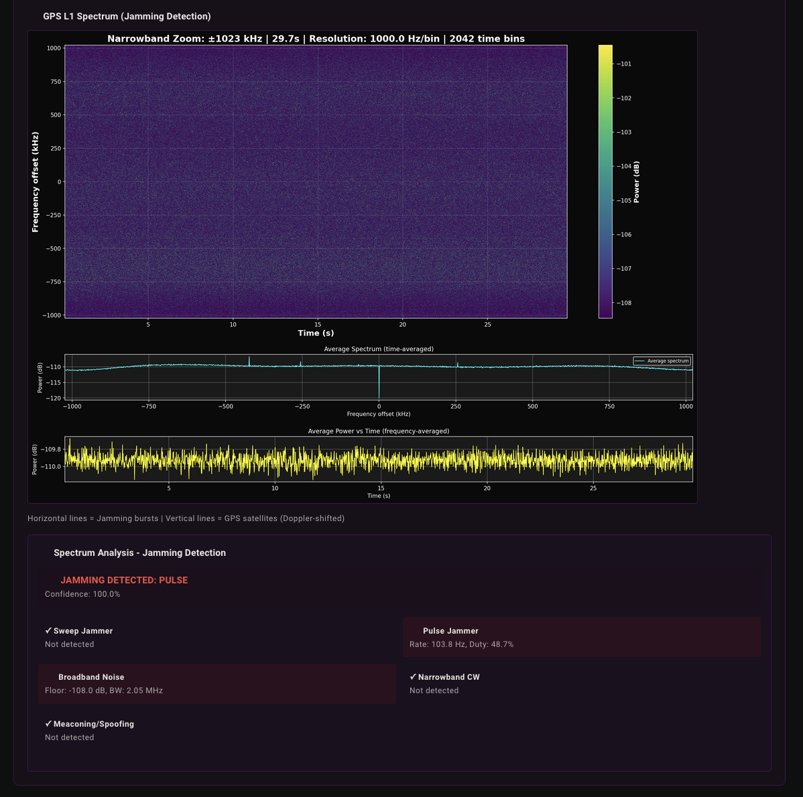
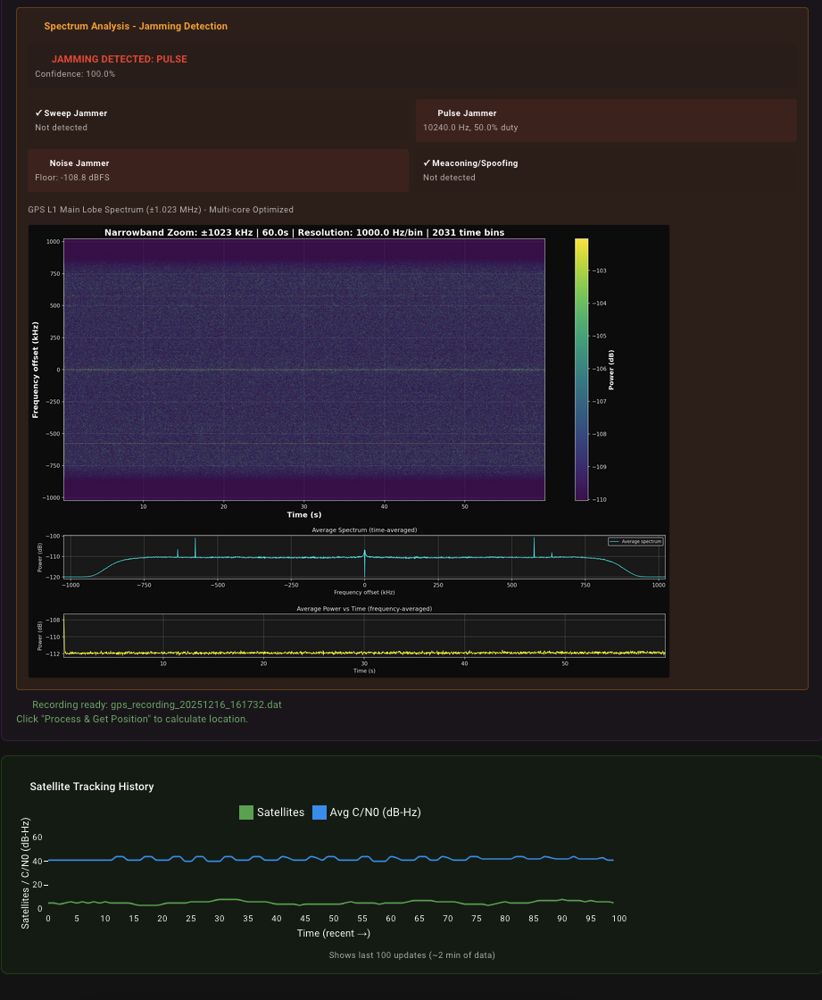

# web-spectrum

網路頻譜分析器與 GPS 訊號分析平台。

請訪問 [patrykorwat.github.io/web-spectrum](https://meshuga.github.io/web-spectrum/) 以使用此應用程式。

## 功能
* **頻譜分析器」 - 即時頻率分析
* **GPS 訊號記錄與分析」 - 專業級 GNSS 處理
* **資料解碼」 - ADS-B、ISM 與多系統 GNSS

## 支援的裝置
* **tinySA Ultra」 - 頻譜分析器
* **RTL-SDR」 (RTL2832U) - 支援 V4 類比棒（$25-40）
* **SDRPlay」 (RSPduo, RSP1A 等) - 專業 SDR 接收器（$200-300）

## 支援的瀏覽器
* Chrome
* Edge
* Opera

查看更多：[caniuse.com/web-serial](https://caniuse.com/web-serial), [caniuse.com/webusb](https://caniuse.com/webusb)

## 安裝

### 前置需求
```bash
# 複製儲存庫
git clone https://github.com/meshuga/web-spectrum.git
cd web-spectrum

# 安裝 Node.js 依賴
npm install
```

### GNSS-SDR 安裝（GPS 分析必需）

GNSS-SDR 專為 SDRPlay 與 RTL-SDR 裝置提供專業 GPS 訊號處理所需。

**macOS 安裝：**
```bash
cd gnss-sdr
./install_gnss_sdr.sh
```

安裝腳本將會：
- 安裝 Homebrew 依賴（Boost、GLOG、Armadillo 等）
- 從原始碼複製並建置 GNSS-SDR
- 安裝至 `/usr/local/bin/gnss-sdr`
- 需時約 30-40 分分鐘

**驗證安裝：**
```bash
gnss-sdr --version
# 應顯示：gnss-sdr version 0.0.19
```

### SDRPlay API 安裝

**macOS：**
```bash
# 從 SDRplay 官方網站下載
# https://www.sdrplay.com/downloads/
# 安裝 SDRplay API v3.15 或更新版本

# 驗證安裝
ls /Library/SDRplayAPI/
# 應顯示：3.15.1（或類似版本）
```

### Python 依賴

使用完整的 requirements 檔案安裝所有必要的 Python 套件：

```bash
# 選項 1：標準安裝（推薦）
pip3 install -r requirements.txt

# 選項 2：macOS 使用 Homebrew Python
pip3 install --break-system-packages -r requirements.txt

# 選項 3：使用虛擬環境（最乾淨）
python3 -m venv venv
source venv/bin/activate  # Windows: venv\Scripts\activate
pip install -r requirements.txt
```

**包含的套件：**
- `numpy` - 訊號處理、FFT、相關運算
- `websockets` - WebSocket 伺服器，用於即時資料串流
- `requests` - Gypsum GPS 解碼器的 HTTP 客戶端
- `python-dateutil` - GPS 時間戳記的日期解析
- 其他 GPS 解碼器支援函式庫

查看 [requirements.txt](requirements.txt) 以取得完整列表與版本限制。

## 快速開始

### 啟動網頁應用程式
```bash
npm start
# 在 http://localhost:3005 開啟瀏覽器
```

### 啟動後端服務（兩種裝置通用）

記錄後端現已自動**同時支援 RTL-SDR 與 SDRPlay**：

```bash
# 簡易方式：使用啟動腳本（從根目錄）
./start_backend.sh
# 啟動 HTTP API（埠口 5001）與 WebSocket（埠口 8766）

# 或手動啟動（從 sdrplay-gps 目錄）：
# 終端機 1：啟動統一記錄 API 伺服器
cd sdrplay-gps
python3 recording_api_simple.py
# 監聽 http://localhost:3001

# 終端機 2：啟動 GNSS-SDR 橋接器（用於即時位置追蹤）
python3 gnss_sdr_bridge.py
# 監聽 ws://localhost:8766
```

**後端功能：**
- ✅ **自動檢測」 - 自動偵測可用的 SDR 裝置（RTL-SDR 或 SDRplay）
- ✅ **雙解碼器支援」 - 可選擇 GNSS-SDR（專業）或 Gypsum（Python 基礎）
- ✅ **格式轉換」 - 將 RTL-SDR uint8 轉換為 complex64 供 GNSS-SDR 使用
- ✅ **自動處理」 - 生成頻譜分析與干擾偵測
- ✅ **WebSocket 串流」 - 即時處理日誌至網頁 UI

**可用的 GPS 解碼器：**
1. **GNSS-SDR」(預設) - 專業 C++ 實作
   - 精確定位修正
   - 完整 NMEA/KML/GPX 輸出
   - 多系統支援
   - 處理時間：5-10 分鐘

2. **Gypsum」 - Python 基礎 GPS 接收器
   - 教育與研究導向
   - 更快處理速度（1-2 分鐘）
   - 最小依賴
   - 適合學習 GPS 訊號處理

在網頁 UI 的「GPS Decoder」下拉選單中選擇解碼器。

### 使用 GPS 記錄功能

1. **開啟瀏覽器」前往 [http://localhost:3005](http://localhost:3005)
2. **導航」至 SDRPlay 或 RTL-SDR 解碼器頁面
3. **設定持續時間」：選擇記錄時間（30 秒至 10 分鐘）
4. **開始記錄」：點擊「⏺ Start Recording」
5. **等待處理」：GNSS-SDR 自動處理
6. **查看結果」：
   - 顯示 GPS 訊號與干擾的頻譜瀑布圖
   - 干擾偵測分析（脈（脈衝、掃描、雜訊、窄頻）
   - 定位修正（緯度、經度、高度）
   - 衛星追蹤狀態

**記錄持續時間：**
- 快速測試：30-60 秒（~468-937 MB）
- 標準：2-5 分鐘（~1.9-4.7 GB）
- 最長：最多 10 分鐘（~9.4 GB）

## 裝置特定功能

### TinySA Ultra


**頻譜分析器模式：**
- 即時頻率掃描與顯示
- 訊號強度測量
- 瀑布顯示

**解碼模式：**
- 觸發式訊號擷取
- 解碼最多約 24 位元的訊息
- 支援各種調變方式

### RTL-SDR




**瀏覽器處理模式：**
直接在瀏覽器中解碼訊號：
- **ADS-B」 - 飛機位置追蹤（1090 MHz）
- **ISM GateTX」 - 433/868 MHz 協定
- **基本 GNSS」 - GPS L1、Galileo E1、GLONASS L1OF、BeiDou B1I

**專業模式（GNSS-SDR）：**

RTL-SDR 類比棒現已與 GNSS-SDR 整合，提供專業 GPS 訊號分析：

**功能：**
- ✅ **可配置記錄」 - 30 秒至 10 分鐘（468 MB 至 9.4 GB）
- ✅ **自動頻譜分析」 - 偵測 GPS 衛星與干擾
- ✅ **位置計算」 - 由 GNSS-SDR 提供緯度、經度、高度
- ✅ **干擾偵測」 - 5 種類型：脈衝、掃描、雜訊、窄頻、偽裝
- ✅ **格式轉換」 - 自動將 uint8 轉換為 complex64
- ✅ **網頁式 UI」 - 在瀏覽器中監控記錄與結果
- ✅ **適用於任何 RTL-SDR 類比棒」 - $25-40（推薦 RTL-SDR Blog V4）

**記錄設定：**
- 頻率：1575.42 MHz（GPS L1 C/A）
- 取樣率：2.048 MSPS
- 增益：40 dB（可配置）
- 格式：Complex64 (IQ) - 自動從 RTL-SDR 的 uint8 轉換
- 支援主動或被動 GPS 天線

**工作流程：**
1. **設定」→ 選擇持續時間（30s-10m）
2. **記錄」→ RTL-SDR 擷取 IQ 樣本至 `.dat` 檔案
3. **處理」→ GNSS-SDR 分析訊號、追蹤衛星
4. **分析」→ Python 生成頻譜瀑布圖與干擾指標
5. **顯示」→ 在網頁 UI 中查看結果

**輸出檔案：**
- `gps_recording_YYYYMMDD_HHMMSS.dat` - 原始 IQ 樣本（complex64）
- `gps_recording_YYYYMMDD_HHMMSS_spectrum.png` - 頻譜瀑布圖
- `gps_recording_YYYYMMDD_HHMMSS_spectrum_analysis.json` - 干擾指標
- `gps_recording_YYYYMMDD_HHMMSS.nmea` - 定位修正（若追蹤到衛星）
- `gps_recording_YYYYMMDD_HHMMSS.kml` - Google Earth 軌跡（若追蹤到衛星）

### SDRPlay (RSPduo, RSP1A 等)



**專業 GPS 記錄與分析：**

SDRPlay 裝置與 GNSS-SDR 整合，提供專業級 GPS 訊號分析：

**功能：**
- ✅ **可配置記錄」 - 1 至 10 分鐘（937 MB 至 9.4 GB）
- ✅ **自動頻譜分析」 - 偵測 GPS 衛星與干擾
- ✅ **位置計算」 - 由 GNSS-SDR 提供緯度、經度、高度
- ✅ **干擾偵測」 - 5 種類型：脈衝、掃描、雜訊、窄頻、偽裝
- ✅ **直接 API 控制」 - Python 基礎的 SDRPlay API（無需 SoapySDR）
- ✅ **網頁式 UI」 - 在瀏覽器中監控記錄與結果
- ✅ **雙調諧器支援」 - RSPduo Port 1 或 Port 2 選擇

**記錄設定：**
- 頻率：1575.42 MHz（GPS L1 C/A）
- 取樣率：2.048 MSPS
- 頻寬：1.536 MHz（擷取 GPS 主波瓣）
- 增益：29 dB（防止熱問題）
- 格式：Complex64 (IQ)
- 調諧器：可選擇（RSPduo Tuner 1 或 2）
- Bias-T：已啟用，適用主動天線

**工作流程：**
1. **設定」→ 選擇持續時間（1m-10m）與調諧器埠口
2. **記錄」→ SDRplay 擷取 IQ 樣本至 `.dat` 檔案
3. **處理」→ GNSS-SDR 分析訊號、追蹤衛星
4. **分析」→ Python 生成頻譜瀑布圖與干擾指標
5. **顯示」→ 在網頁 UI 中查看結果

**輸出檔案：**
- `gps_recording_YYYYMMDD_HHMMSS.dat` - 原始 IQ 樣本（complex64）
- `gps_recording_YYYYMMDD_HHMMSS_spectrum.png` - 頻譜瀑布圖
- `gps_recording_YYYYMMDD_HHMMSS_spectrum_analysis.json` - 干擾指標
- `gps_recording_YYYYMMDD_HHMMSS.nmea` - 定位修正（若追蹤到衛星）
- `gps_recording_YYYYMMDD_HHMMSS.kml` - Google Earth 軌跡（若追蹤到衛星）

**支援的系統：**
- GPS L1 C/A (美國) - 1575.42 MHz
- Galileo E1 (歐洲) - 1575.42 MHz
- GLONASS L1OF (俄羅斯) - 1602 MHz
- BeiDou B1I (中國) - 1561.098 MHz

## 參考資料

YouTube 影片說明與測試：
* [Web (r)evolution in lab electronics? Building a Web Spectrum Analyzer for TinySA Ultra](https://www.youtube.com/watch?v=XeK0TL0F8DI)
* [Signal decoding with TinySA Ultra](https://www.youtube.com/watch?v=bqgmftWSKPc)
* [RTL-SDR signal decoding in a web application](https://www.youtube.com/watch?v=Wm7sMXXT5Xs)

## 開發

在專案目錄中，您可以執行：

### `npm start`

以開發模式執行應用程式。\
在瀏覽器中開啟 [http://localhost:3005](http://localhost:3005) 以檢視。

當您進行變更時，頁面將自動重新載入。\
您也可能在控制台看到 lint 錯誤。

### `npm test`

啟動測試執行器進入互動監視模式。\
查看 [執行測試](https://facebook.github.io/create-react-app/docs/running-tests) 章節以取得更多資訊。

### `npm run build`

建置應用程式至 `build` 資料夾以進行生產部署。\
將在生產模式中正確打包 React 並最佳化建置以獲得最佳效能。

建置已最小化且檔名包含雜湊值。\
您的應用程式已準備部署！

查看 [部署](https://facebook.github.io/create-react-app/docs/deployment) 章節以取得更多資訊。
